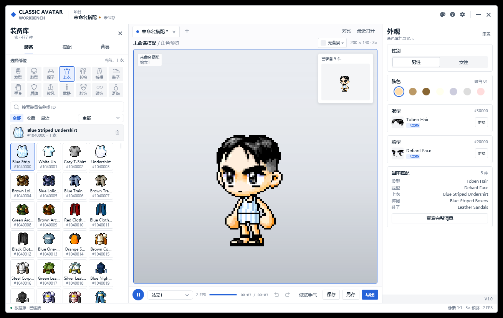

# Classic Avatar

[简体中文](README.md) | [繁體中文](README.zh-TW.md) | [English](README.en-US.md)



Classic Avatar V1.0 is a **local, offline outfit workbench** for classic MapleStory avatars. Browse equipment, preview the character instantly, save outfits, and export PNG, GIF, TXT, or `.avatar` files.

Everything is read from the local game `Data` folder. The app does not connect to the internet and never uploads anything.

## Download

Get the latest build from [GitHub Releases](https://github.com/wyf237/ClassicAvatar/releases/latest):

| Package | Description |
|---|---|
| **ClassicAvatar-v1.0-win-x64-full.zip** | Full release with the .NET runtime included; double-click to run |
| **ClassicAvatar-v1.0-win-x64-lite.zip** | Lite release; requires .NET 10 Desktop Runtime |

Both packages include a `Docs/` folder:

- `使用方法.pdf` (Simplified Chinese)
- `使用說明.pdf` (Traditional Chinese)
- `User Guide.pdf` (English)

## Features

- 14 equipment slots, fixed four-column cards; single-click to try, double-click to equip.
- Gender filtering: male shows male + unisex, female shows female + unisex.
- Normal / cash filters, favorites, recent items, and search by name or ID.
- Two-handed weapons automatically hide the shield, including spears, polearms, two-handed swords/axes/blunts, bows, and crossbows.
- Live character preview, Compare mode, 1:1 mini preview, and background images.
- 22 colorways and Simplified Chinese, Traditional Chinese, and English UI.
- Consistent VDialog modal prompts for saving, F2 rename, settings, the full outfit list, and unsaved changes.
- Manual save only; no auto-save. Saving asks for an outfit name and confirms overwrites.
- Export PNG / GIF / TXT / `.avatar`.
- First launch asks the user to choose the game `Data` folder; no path is hard-coded.
- Switching equipment slots releases the previous slot's WZ package and icon cache to keep memory low.

## First launch

1. Extract the release package and double-click `ClassicAvatar.exe`.
2. In the First launch window, click **Choose folder...**.
3. Select the game `Data` folder containing `Base`, `Character`, `Item`, and similar folders.
4. Click **Continue**. The selection is remembered and reopened next time.
5. Change it later under **Settings → Game Data folder**.

> Choose `.../appdata/Data`, not the game root folder.

## Saving and exporting

- Click **Save** or press `Ctrl+S`, enter an outfit name in the VDialog.
- Press `F2` to rename the current outfit; the new name is written on the next save.
- The save folder is configured in Settings. Closing a dirty tab or the window asks for confirmation.
- The Export menu provides PNG, GIF, and TXT; use Save As for `.avatar`.

## Requirements

- Windows 10 / 11 (64-bit)
- Recommended resolution: 1440 × 900 or higher
- Full release: no .NET installation required
- Lite release: requires [.NET 10 Desktop Runtime](https://dotnet.microsoft.com/download/dotnet/10.0)

## Build from source

The repository includes the Avatar.Core, VControls, and WZReader sources under `Dependencies/`; no sibling checkout is required.

Install the **.NET 10 SDK**, then:

```powershell
git clone https://github.com/wyf237/ClassicAvatar.git
cd ClassicAvatar
dotnet build ClassicAvatar.slnx -c Release
```

Publish the full release:

```powershell
dotnet publish ClassicAvatar/ClassicAvatar.csproj `
  -c Release -r win-x64 --self-contained true `
  -p:PublishTrimmed=false `
  -o publish/full
```

Publish the lite release:

```powershell
dotnet publish ClassicAvatar/ClassicAvatar.csproj `
  -c Release -r win-x64 --self-contained false `
  -o publish/lite
```

## Project layout

```text
ClassicAvatar/
  ClassicAvatar/         WPF application
    Views/               main window and VDialog dialogs
    Services/            icon cache, theme/settings persistence
    Themes/               22 colorways and C2 styles
    Resources/            SVG icons, strings, backgrounds
    docs/manual/         three-language PDF manuals
  Dependencies/          Avatar.Core / VControls / WZReader sources
  docs/                  README screenshots and project docs
  README.md              Simplified Chinese
  README.zh-TW.md        Traditional Chinese
  README.en-US.md        English
```

## Documentation

- [Architecture](ClassicAvatar/docs/ARCHITECTURE.md)
- [Performance](ClassicAvatar/docs/PERFORMANCE.md)
- [Error handling](ClassicAvatar/docs/ERROR_HANDLING.md)
- [PDF manuals](ClassicAvatar/docs/manual) (Simplified Chinese / Traditional Chinese / English)

## Author

- Author: Vico (乔峰的音响)
- Character: Alita
- Bug reports: wyf237@126.com (China) · wyf23259@gmail.com (Other)

If you like this app, please fame me in game, thank you!
