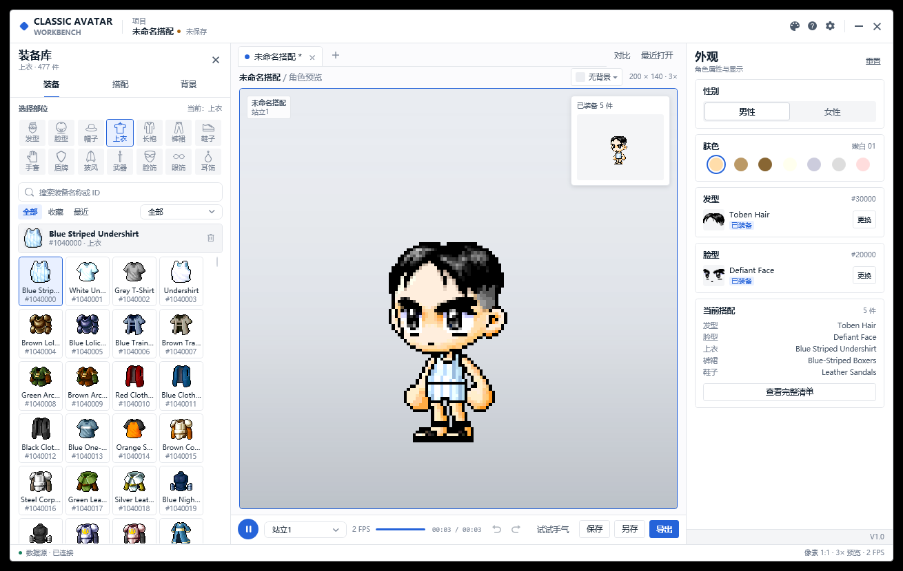

# Classic Avatar

[简体中文](README.md) | [繁體中文](README.zh-TW.md) | [English](README.en-US.md)



Classic Avatar V1.0.1 是一款面向冒险岛经典版本的**本地离线角色配装工具**。浏览装备、实时预览、保存搭配，并导出 PNG、GIF、TXT 或 `.avatar` 搭配文件。

所有素材均读取自本机游戏 `Data` 目录，软件不联网、不上传任何内容。

## 下载

请前往 [GitHub Releases](https://github.com/wyf237/ClassicAvatar/releases/latest) 下载最新版本：

| 版本 | 说明 |
|---|---|
| **ClassicAvatar-v1.0.1-win-x64-full.zip** | 全量发布，自带 .NET 运行时，双击即可运行 |
| **ClassicAvatar-v1.0.1-win-x64-lite.zip** | 简量发布，体积小，需要安装 .NET 10 Desktop Runtime |

两个版本内均包含 `Docs/` 使用说明：

- `使用方法.pdf`（简体中文）
- `使用說明.pdf`（繁體中文）
- `User Guide.pdf`（English）

## 功能

- 14 个装备部位，固定四列卡片，单击试穿、双击装备。
- 按性别筛选：男性显示男装 + 通用，女性显示女装 + 通用。
- 普通 / 现金筛选、收藏、最近使用、名称或 ID 搜索。
- 双手武器自动隐藏盾牌，包括长枪、长矛、双手剑/斧/钝器、弓和十字弓。
- 实时角色预览、对比模式、原尺寸小窗和背景图片。
- 22 套配色，支持简体中文、繁體中文、English。
- VDialog 统一弹窗：保存命名、F2 重命名、设置、完整清单、未保存提示。
- 手动保存，不自动写盘；保存前可输入搭配名称，同名覆盖会确认。
- 导出 PNG / GIF / TXT / `.avatar`。
- 首次启动由用户选择游戏 `Data` 目录，不在程序中写死路径。
- 切换装备列表后自动释放上一部位的 WZ 包和图标缓存，降低内存占用。

## 首次启动

1. 解压发布包并双击 `ClassicAvatar.exe`。
2. 在“首次使用”窗口点击“选择文件夹...”。
3. 选择包含 `Base`、`Character`、`Item` 等文件夹的游戏 `Data` 目录。
4. 点击“继续”。选择会被记住，下次启动自动打开。
5. 之后可在右上角“设置 → 游戏数据目录”中更换。

> 请选择 `.../appdata/Data`，不要选择游戏根目录。

## 保存与导出

- 点击“保存”或按 `Ctrl+S`，在 VDialog 中输入搭配名称。
- 按 `F2` 重命名当前搭配，保存后写入新名称。
- 保存目录在“设置”中配置；关闭有未保存修改的标签页或窗口时会确认。
- “导出”菜单提供 PNG、GIF、TXT 三种格式；“另存为”用于保存 `.avatar`。

## 系统要求

- Windows 10 / 11（64 位）
- 推荐分辨率：1440 × 900 或更高
- 全量版：无需安装 .NET
- 简量版：需要 [.NET 10 Desktop Runtime](https://dotnet.microsoft.com/download/dotnet/10.0)

## 从源码构建

仓库已包含 `Dependencies/` 下的 Avatar.Core、VControls 和 WZReader 源码，无需额外的兄弟目录。

需要安装 **.NET 10 SDK**：

```powershell
git clone https://github.com/wyf237/ClassicAvatar.git
cd ClassicAvatar
dotnet build ClassicAvatar.slnx -c Release
```

发布全量版：

```powershell
dotnet publish ClassicAvatar/ClassicAvatar.csproj `
  -c Release -r win-x64 --self-contained true `
  -p:PublishTrimmed=false `
  -o publish/full
```

发布简量版：

```powershell
dotnet publish ClassicAvatar/ClassicAvatar.csproj `
  -c Release -r win-x64 --self-contained false `
  -o publish/lite
```

## 项目结构

```text
ClassicAvatar/
  ClassicAvatar/         WPF 主程序
    Views/               主窗口与 VDialog 弹窗
    Services/            图标缓存、主题/设置持久化
    Themes/              22 套配色与 C2 样式
    Resources/           SVG 图标、字符串、背景
    docs/manual/         三语言 PDF 说明书
  Dependencies/          Avatar.Core / VControls / WZReader 源码
  docs/                  README 截图与项目文档
  README.md              简体中文
  README.zh-TW.md        繁體中文
  README.en-US.md        English
```

## 更新记录

- [CHANGELOG.md](CHANGELOG.md)

## 文档

- [架构说明](ClassicAvatar/docs/ARCHITECTURE.md)
- [性能说明](ClassicAvatar/docs/PERFORMANCE.md)
- [错误处理](ClassicAvatar/docs/ERROR_HANDLING.md)
- [使用说明 PDF](ClassicAvatar/docs/manual)（简中 / 繁中 / English）

## 作者

- 作者：乔峰的音响（English: Vico）
- 游戏角色：Alita
- BUG 建议：wyf237@126.com（中国） · wyf23259@gmail.com（其他）

如果喜欢本软件，请在游戏中为我加一点人气，谢谢！


