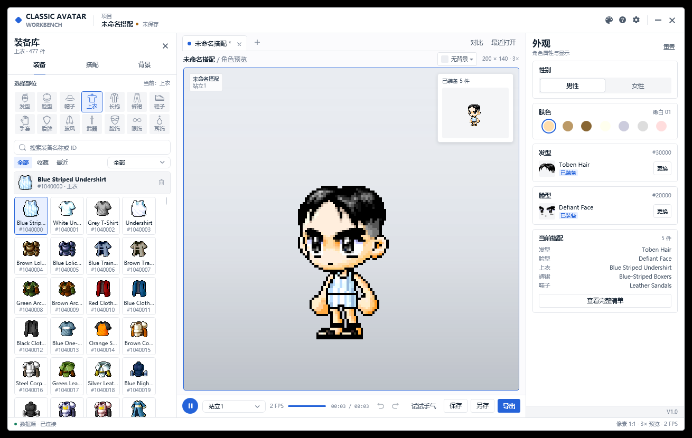

# Classic Avatar

[简体中文](README.md) | [繁體中文](README.zh-TW.md) | [English](README.en-US.md)



Classic Avatar V1.0.1 是一款面向新楓之谷經典版本的**本機離線角色配裝工具**。瀏覽裝備、即時預覽、儲存搭配，並匯出 PNG、GIF、TXT 或 `.avatar` 搭配檔。

所有素材均讀取自本機遊戲 `Data` 目錄，軟體不連網、不上傳任何內容。

## 下載

請前往 [GitHub Releases](https://github.com/wyf237/ClassicAvatar/releases/latest) 下載最新版本：

| 版本 | 說明 |
|---|---|
| **ClassicAvatar-v1.0.1-win-x64-full.zip** | 全量發佈，自帶 .NET 執行階段，雙擊即可執行 |
| **ClassicAvatar-v1.0.1-win-x64-lite.zip** | 簡量發佈，體積小，需安裝 .NET 10 Desktop Runtime |

兩個版本內均包含 `Docs/` 使用說明：

- `使用方法.pdf`（简体中文）
- `使用說明.pdf`（繁體中文）
- `User Guide.pdf`（English）

## 功能

- 14 個裝備部位，固定四欄卡片，單擊試穿、雙擊裝備。
- 依性別篩選：男性顯示男裝 + 通用，女性顯示女裝 + 通用。
- 普通 / 現金篩選、收藏、最近使用、名稱或 ID 搜尋。
- 雙手武器自動隱藏盾牌，包括長槍、長矛、雙手劍/斧/鈍器、弓與十字弓。
- 即時角色預覽、對比模式、原尺寸小窗與背景圖片。
- 22 套配色，支援简体中文、繁體中文、English。
- VDialog 統一彈窗：儲存命名、F2 重新命名、設定、完整清單、未儲存提示。
- 手動儲存，不自動寫入；儲存前可輸入搭配名稱，同名覆寫會確認。
- 匯出 PNG / GIF / TXT / `.avatar`。
- 首次啟動由使用者選擇遊戲 `Data` 目錄，不在程式內寫死路徑。
- 切換裝備清單後自動釋放上一部位的 WZ 包與圖示快取，降低記憶體佔用。

## 首次啟動

1. 解壓縮發佈包並雙擊 `ClassicAvatar.exe`。
2. 在「首次使用」視窗點擊「選擇資料夾...」。
3. 選擇包含 `Base`、`Character`、`Item` 等資料夾的遊戲 `Data` 目錄。
4. 點擊「繼續」。選擇會被記住，下次啟動自動開啟。
5. 之後可在右上角「設定 → 遊戲資料目錄」中更換。

> 請選擇 `.../appdata/Data`，不要選擇遊戲根目錄。

## 儲存與匯出

- 點擊「儲存」或按 `Ctrl+S`，在 VDialog 中輸入搭配名稱。
- 按 `F2` 重新命名目前搭配，儲存後寫入新名稱。
- 儲存目錄在「設定」中設定；關閉有未儲存修改的頁籤或視窗時會確認。
- 「匯出」選單提供 PNG、GIF、TXT 三種格式；「另存為」用於儲存 `.avatar`。

## 系統需求

- Windows 10 / 11（64 位元）
- 建議解析度：1440 × 900 或更高
- 全量版：無需安裝 .NET
- 簡量版：需要 [.NET 10 Desktop Runtime](https://dotnet.microsoft.com/download/dotnet/10.0)

## 從原始碼建置

倉庫已包含 `Dependencies/` 下的 Avatar.Core、VControls 與 WZReader 原始碼，無需額外的兄弟目錄。

需要安裝 **.NET 10 SDK**：

```powershell
git clone https://github.com/wyf237/ClassicAvatar.git
cd ClassicAvatar
dotnet build ClassicAvatar.slnx -c Release
```

發佈全量版：

```powershell
dotnet publish ClassicAvatar/ClassicAvatar.csproj `
  -c Release -r win-x64 --self-contained true `
  -p:PublishTrimmed=false `
  -o publish/full
```

發佈簡量版：

```powershell
dotnet publish ClassicAvatar/ClassicAvatar.csproj `
  -c Release -r win-x64 --self-contained false `
  -o publish/lite
```

## 專案結構

```text
ClassicAvatar/
  ClassicAvatar/         WPF 主程式
    Views/               主視窗與 VDialog 彈窗
    Services/            圖示快取、主題/設定持久化
    Themes/              22 套配色與 C2 樣式
    Resources/           SVG 圖示、字串、背景
    docs/manual/         三語言 PDF 說明書
  Dependencies/          Avatar.Core / VControls / WZReader 原始碼
  docs/                  README 截圖與專案文件
  README.md              简体中文
  README.zh-TW.md        繁體中文
  README.en-US.md        English
```

## 更新記錄

- [CHANGELOG.md](CHANGELOG.md)

## 文件

- [架構說明](ClassicAvatar/docs/ARCHITECTURE.md)
- [效能說明](ClassicAvatar/docs/PERFORMANCE.md)
- [錯誤處理](ClassicAvatar/docs/ERROR_HANDLING.md)
- [使用說明 PDF](ClassicAvatar/docs/manual)（简体中文 / 繁體中文 / English）

## 作者

- 作者：喬峰的音響（English: Vico）
- 遊戲角色：Alita
- BUG 建議：wyf237@126.com（中國） · wyf23259@gmail.com（其他）

如果喜歡本軟體，請在遊戲中為我加一點人氣，謝謝！


